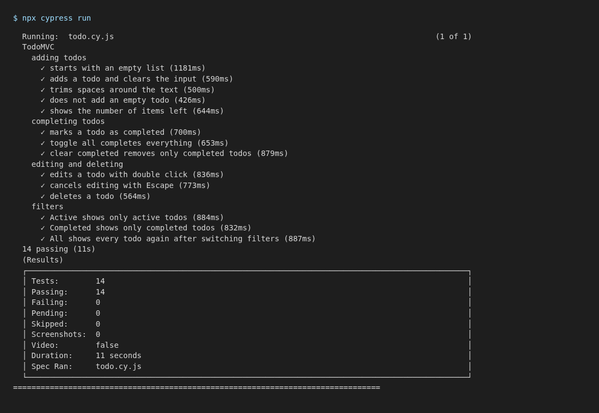

# TodoMVC Cypress tests

End to end tests with [Cypress](https://www.cypress.io) for the React version of [TodoMVC](https://todomvc.com/examples/react/dist/), a small todo app that is often used to compare frameworks. I picked it because it has real user behaviour (add, edit, complete, filter) in a small surface.



## What is tested

| Area | Tests |
|---|---|
| Adding | empty list at start, add + input cleared, text is trimmed, empty todo is ignored, items-left counter |
| Completing | complete one, toggle all, clear completed |
| Editing and deleting | edit with double click, cancel with Escape, delete |
| Filters | Active, Completed, back to All |

14 tests. Selectors use the app's `data-testid` attributes where they exist.

## Run it

```bash
git clone https://github.com/Belaalos/todomvc-cypress-tests.git
cd todomvc-cypress-tests
npm install
npm test            # headless
npm run open        # Cypress app, see the browser
```

Runs on GitHub Actions on every push.

## Something I learned

I first wrote a "todos are kept after a reload" test and it failed. The React example keeps its state in memory only, so that is how the app is built, not a bug. I replaced it with a filter test.

Belal Magdy | QA | [LinkedIn](https://www.linkedin.com/in/belal-magdy-23sep2001)
